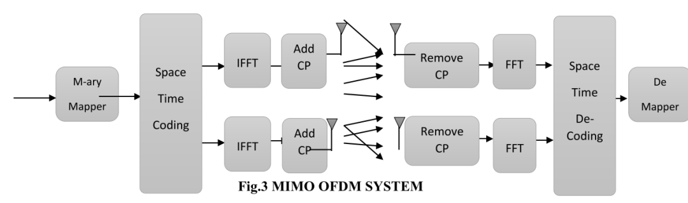
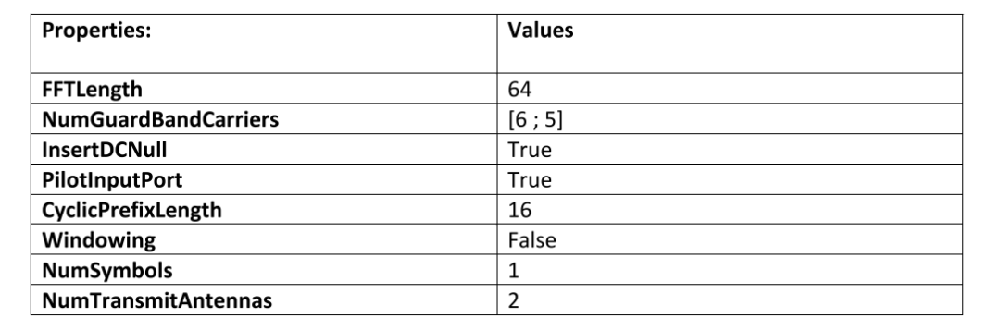
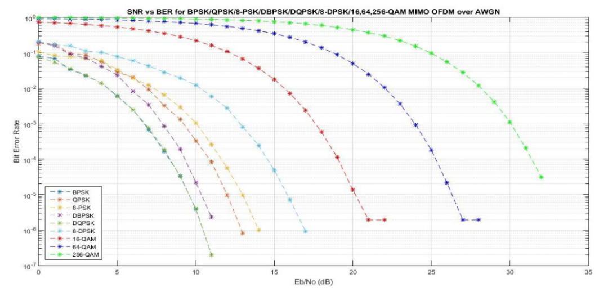
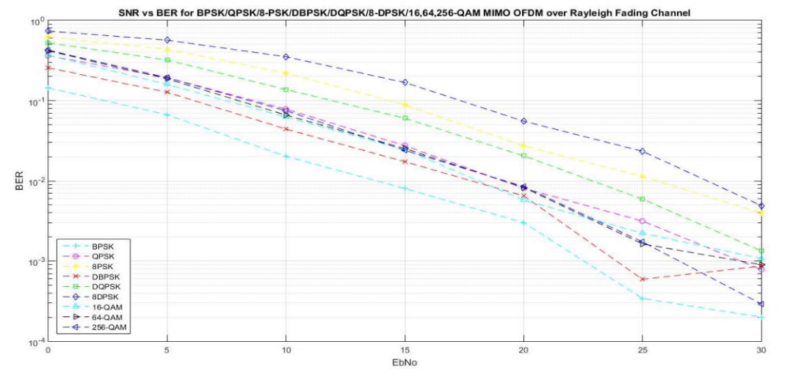
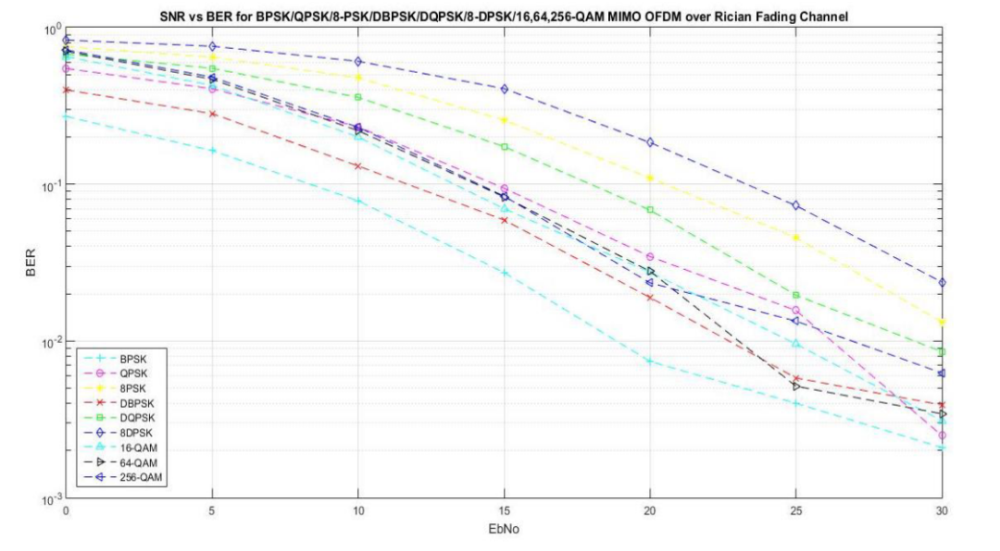

# [MIMO-OFDM]Performance Analysis of MIMO-OFDM System under Different Modulation Methods in Different Fading Channels[with MATLAB Code]

In the modern world, there is a rapid convergence of high data usage rates for ultra-reliable and high-speed (URHs) transmissions. Telecommunication providers have recognized this as a major issue and are actively researching an ideal solution. OFDM has been widely adopted in the past decade, being one of the most promising solutions. Its significance lies in its prominent areas such as reliability, robustness, frequency selective fading, and ease of implementation.
In recent years, the idea of using MIMO has gained prominence, as it employs multicarrier technology. This involves using multiple antennas at both the transmitter and receiver. The receiver selects the best received signal from the transmitter based on the selected antennas. MIMO achieves array gain by transmitting the same total power across all antennas, thereby increasing spectral efficiency (bits per second per hertz bandwidth) or link reliability (reduced fading), thus providing high resolution and reliability. High data rates and performance are essential, making wireless systems prefer MIMO over SISO (Single Input Single Output).
Wireless communication systems operating in narrowband spectrums are considered advantageous for MIMO-OFDM. To realize this in the physical network, numerous modifications are required, which can include time and frequency synchronization, channel estimation, and MIMO detection.
The goal of this project is to categorize the system based on the use of channel estimation and modulation techniques in the Multi-Input Multi-Output Orthogonal Frequency Division Multiplexing (MIMO-OFDM) system. It introduces the implementation of BPSK, QPSK, M-PSK, D-BPSK, DQPSK, DPSK, and QAM in AWGN, Rayleigh, and Rician channels. Performance measurements are made relative to bit error rate and signal-to-noise ratio, and implemented using MATLAB.
MIMO-OFDM System Model
Channel a. AWGN Channel
The Additive White Gaussian Noise (AWGN) channel is widely used for analyzing different modulation schemes. The channel adds white noise to the signal passing through it. The advantage of using this channel is that it does not experience fading.
b. Rayleigh Channel
In Rayleigh fading channels, signals are subject to the influence of the Rayleigh distribution as they pass through the channel. Multipath reception is the fundamental cause of Rayleigh fading. Antennas receive a large number of reflected and scattered waves. The multipath effect causes both constructive and destructive interference. When non-line-of-sight communication is established between the transmitter and receiver, Rayleigh fading becomes more accurate.
c. RICIAN Channel
In Rayleigh fading channels, the amplitude gain follows the Rayleigh distribution. Here, the channel involves line-of-sight signals between the transmitter and receiver. Rayleigh fading occurs when one of the received signals is stronger (usually the line-of-sight component) compared to another.
Modulation techniques play an important role in wireless communication. It is a method for processing data symbols that need to be transmitted over the carrier. Today, most wireless transmissions are essentially digital, and the key use of bandwidth is significant. The type of modulation used at this step plays a crucial role, where the constellation diagram determines the use of bandwidth. One goal of modulation is to achieve maximum spectral efficiency (i.e., compressing as much data into as little spectrum as possible. Spectral efficiency measures the speed at which data can be transmitted within a specified bandwidth. The measurement unit is bits per second per hertz (B/s/Hz). Several technologies have been developed to achieve and improve spectral efficiency. In this project, we use BPSK, QPSK, M-PSK, D-BPSK, DQPSK, DPSK, and QAM.
The simulation design implemented in this project involves MIMO-OFDM and comparisons of different modulation schemes in various wireless channels. MIMO-OFDM is the combination of MIMO and OFDM. Therefore, multiple inputs and outputs are added to the orthogonal frequency division multiplexing. Here, besides eliminating inter-symbol interference, the removal of Inter-Symbol Interference due to signal processing also increases spectral efficiency, allowing more users to share the available bandwidth. This implementation was performed using MATLAB.
a. Comparison in AWGN
In the MIMO-OFDM system, different modulation methods are adopted for AWGN channels to observe the system's efficiency. Simulations have produced a graph of the relationship between bit error rate and signal-to-noise ratio (SNR). Systems that minimize the bit error rate even at low SNR are considered effective. The results indicate that at any given time, if the SNR is 0, the higher the SNR, the lower the bit error rate. At a 10 dB performance level, the bit error rate is minimal for 256 QAM and maximal for DQPSK. When repeating this process with more modulation schemes, a clear concept about efficiency emerges, enabling optimal selection based on requirements.
b. Rayleigh comparison
Under similar conditions, a similar process is applied to the Rayleigh channel. Based on the efficiency obtained from simulation results (i.e., bit error rate vs. SNR), it helps display the most suitable modulation scheme according to user requirements. This graph shows that when plotted against SNR, the bit error rate for 8 DPSK is minimal, while that for BPSK is maximal (e.g., 10 dB). This result proves that compared to the AWGN channel, the modulation efficiency varies with the channel and yields different outcomes.
c. Rician fading channel comparison
The following simulation output demonstrates that under Rayleigh fading channels, 8 DPSK has a higher efficiency than other considered modulation schemes. Among the considered modulation techniques in this channel, BPSK has the lowest efficiency. Therefore, for users requiring high spectral efficiency and accuracy, 8 DPSK is proven to be the best technology compared to other modulation schemes in this project.
Conclusion: The purpose of this plan is to analyze the efficacy of different modulation methods under MIMO-OFDM systems in AWGN, Rayleigh, and Rician fading channels. This aids in obtaining the efficiency of modulation techniques in terms of accuracy or reliability by plotting the bit error rate against SNR. This can be further enhanced by applying more modulation schemes across different wireless communication channels within the MIMO-OFDM system.

## Images

<!-- PAYMENT_BLOCK -->

## Get this dataset

- Payment link (Stripe): [Buy now](https://buy.stripe.com/3cs8yP7sY87d0vu9AB)
- Payment QR code: 

<!-- /PAYMENT_BLOCK -->
